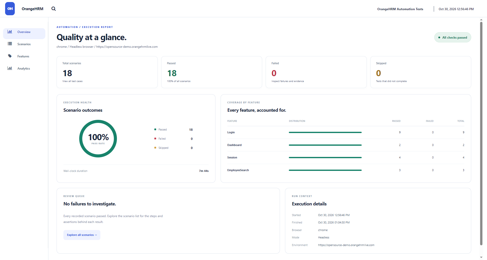
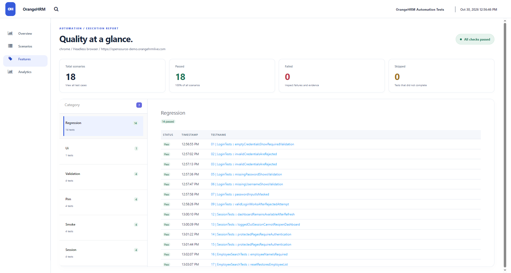
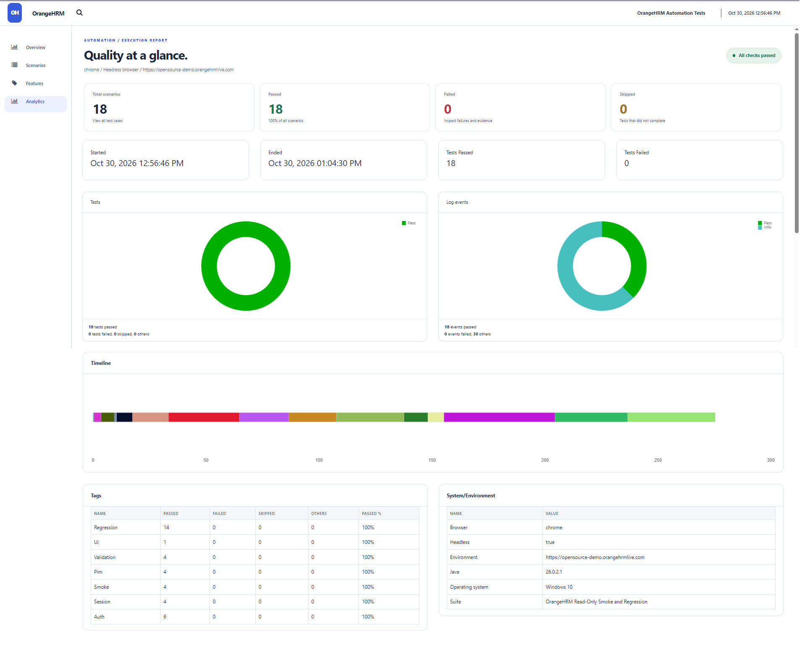

# OrangeHRM | Selenium Java Automation Framework

**Project 02** in the [`qa-web-automation-selenium`](https://github.com/janessa2297/qa-web-automation-selenium) portfolio. An independent Maven / Selenium WebDriver / TestNG automation project for the [OrangeHRM public demo](https://opensource-demo.orangehrmlive.com/web/index.php/auth/login).

> **Status: Chrome headless suite verified on October 30, 2026.** All 18 authentication, session, navigation, and PIM validation/search tests passed against the public demo (0 failures, errors, or skips). The final run took approximately 7 minutes 46 seconds. Edge, Firefox, and the opt-in employee write suite remain unverified.

## Why this project exists

SauceDemo covers e-commerce and cart/checkout flows. OrangeHRM demonstrates enterprise workflows: authentication, dashboard/navigation, and PIM employee management. The emphasis is on maintainability, isolated browser sessions, data-driven testing, readable assertions, and reporting.

## Technology

- Java 17+ / Maven 3.9+
- Selenium WebDriver 4.51.0 (Selenium Manager: browser driver automatically resolved)
- TestNG 7.12.0
- ExtentReports 5.1.2 + failure screenshots
- Page Object Model + explicit waits + ThreadLocal WebDriver
- Chrome / Edge / Firefox (installed browser required)
- Optional manually triggered GitHub Actions workflow

## Project layout

```text
orangehrm-testing/
├── pom.xml
├── testng.xml                         # Default read-only suite
├── write-testng.xml                   # Opt-in create/search/delete suite
├── src/
│   ├── main/
│   │   ├── java/com/portfolio/orangehrm/
│   │   │   ├── config/FrameworkConfig.java
│   │   │   ├── driver/DriverFactory.java
│   │   │   └── pages/
│   │   │       ├── BasePage.java
│   │   │       ├── LoginPage.java
│   │   │       ├── DashboardPage.java
│   │   │       ├── EmployeeListPage.java
│   │   │       └── AddEmployeePage.java
│   │   └── resources/config.properties
│   └── test/java/com/portfolio/orangehrm/
│       ├── base/BaseTest.java
│       ├── data/LoginData.java
│       ├── reporting/ExtentReportListener.java
│       ├── reporting/ScreenshotHelper.java
│       └── tests/
│           ├── LoginTests.java
│           ├── DashboardTests.java
│           └── EmployeeLifecycleWriteTests.java
└── docs/
    ├── TEST_PLAN.md
    └── FRAMEWORK_ARCHITECTURE.md
```

## Prerequisites

Install **JDK 17 or newer**, **Maven**, and **Google Chrome**, **Microsoft Edge**, or **Firefox**. Check from the VS Code terminal:

```powershell
java -version
mvn -version
```

The browser must be installed on your PC. Selenium Manager automatically downloads or resolves a compatible driver when needed.

## Quick start (PowerShell / VS Code)

Open a terminal in the project folder:

```powershell
cd C:\Users\Nexza\vscode-workspace\OrangeHRM_Selenium_Framework\orangehrm-testing
mvn clean test
```

If Maven reports that it cannot create `C:\.m2\repository`, explicitly select your user cache in PowerShell:

```powershell
mvn "-Dmaven.repo.local=$env:USERPROFILE/.m2/repository" clean test
```

The default suite contains **18 test invocations** covering login, invalid-login recovery, individual required fields, password masking, protected routes, logout, session refresh, PIM navigation, unknown employee search, reset, and required employee names. It runs independent browser sessions sequentially. Employee-name validation submits an invalid form without creating a record.

Run Microsoft Edge instead of Chrome:

```powershell
mvn clean test -Dbrowser=edge
```

Run headless Chrome:

```powershell
mvn clean test -Dheadless=true
```

Run Chrome with a longer explicit wait:

```powershell
mvn clean test -Dwait.seconds=30
```

The test site publishes `Admin` / `admin123` as **public demo credentials**, used as defaults here. To run against a different environment, supply credentials through environment variables, not committed files:

```powershell
$env:ORANGEHRM_USERNAME = 'your-username'
$env:ORANGEHRM_PASSWORD = 'your-password'
$env:BASE_URL = 'https://your-test-environment.example'
mvn clean test
```

If these are private credentials, **never commit them**, and remove sensitive variables from your terminal session when finished.

## Test results and artifacts

After a run, open:

- `target/reports/extent.html` — Extent HTML report
- `target/screenshots/` — screenshots captured on failed tests
- `target/surefire-reports/` — Maven / TestNG results

All are ignored by Git. Include only *sanitized, selected* screenshots in your portfolio documentation once tests are actually verified.

The Extent Spark report includes a dark dashboard, status charts, timeline, duration, scenario descriptions, group filters, step logs for new workflows, environment details, and setup/teardown failures. Screenshots are captured for passed and failed tests and embedded in the HTML, so screenshot evidence stays with the report when shared. Raw test parameters are omitted from display names to avoid exposing credential data. Each run replaces `extent.html`; copy it before another run if you want to retain it. The reporter may require internet access for its CSS/JavaScript assets.

## Employee lifecycle write test — manual opt-in only

The OrangeHRM public demo is a **shared, resettable environment**. The employee E2E test **creates a record**, searches by its generated employee ID, and attempts to delete **only its own** record. It is excluded from the default suite. Do not run repeated destructive tests against a public environment; prefer a private controlled instance.

To opt in explicitly:

```powershell
mvn clean test -DsuiteXmlFile=write-testng.xml -Dallow.write.tests=true
```

The test adds a unique employee name and performs best-effort cleanup. If the application resets during execution or cleanup fails, a test-created record might remain. Never run this without understanding its side effects.

## Test plan and design

See [`docs/TEST_PLAN.md`](docs/TEST_PLAN.md) and [`docs/FRAMEWORK_ARCHITECTURE.md`](docs/FRAMEWORK_ARCHITECTURE.md). The overall intent is **unit-of-behavior scenarios**, not one large brittle end-to-end test.

## Local Git steps (after verification)

From the root `qa-web-automation-selenium/` folder:

```powershell
git status
git add orangehrm-testing/ .github/workflows/orangehrm-smoke.yml
git commit -m "Add OrangeHRM Selenium automation framework"
git push origin main
```

Do not commit the project as verified or passing until you actually run the tests. GitHub Actions is **manual-only** by design, to avoid hammering a shared demo.

## Roadmap

- [x] Page Object Model framework structure
- [x] Read-only authentication and navigation test implementations
- [x] TestNG DataProvider negative test coverage
- [x] Extent HTML reporting and failure screenshots
- [x] Opt-in PIM create/search/delete E2E test implementation
- [x] Run and debug smoke tests against the current demo
- [x] Run and verify on Chrome (headless)
- [ ] Run and verify on Edge
- [ ] Add PIM field validation + employee edit workflow
- [ ] Add sanitized evidence/screenshots for GitHub
- [ ] Explore CI with a controlled/stable test environment

## 📸 Test Execution Evidence

The following screenshots demonstrate the OrangeHRM Selenium Automation Framework's execution results, functional coverage, and reporting capabilities.

### 1. Test Execution Overview

Provides a summary of the automated test execution, including passed, failed, and skipped scenarios.



### 2. Feature Coverage

Displays the application features covered by the automated test suite.



### 3. Test Execution Analytics

Presents execution statistics, test outcome distribution, and reporting information.



---

## 📊 HTML Test Execution Report

The complete OrangeHRM HTML execution report is available in the [`reports/`](reports/) directory.

### How to View the Report

1. Download the HTML report and any associated resource folder.
2. Locate the downloaded HTML file.
3. Right-click the HTML file.
4. Select **Open with** and choose Google Chrome, Microsoft Edge, or another browser.
5. Navigate through the available report sections to review execution results.

**Note:** The HTML report is an archived execution artifact. Test results represent the recorded execution and may differ in future runs.

## Notes

This project is for educational QA automation portfolio use and is not affiliated with OrangeHRM. UI selectors and demo credentials can change. Do not confuse a working test scaffold with verified test execution.
