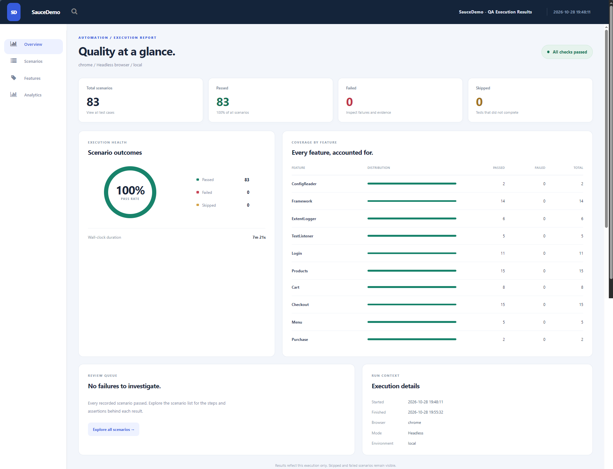
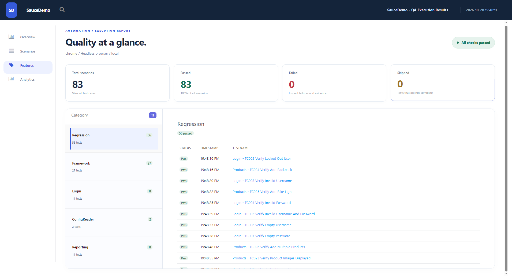
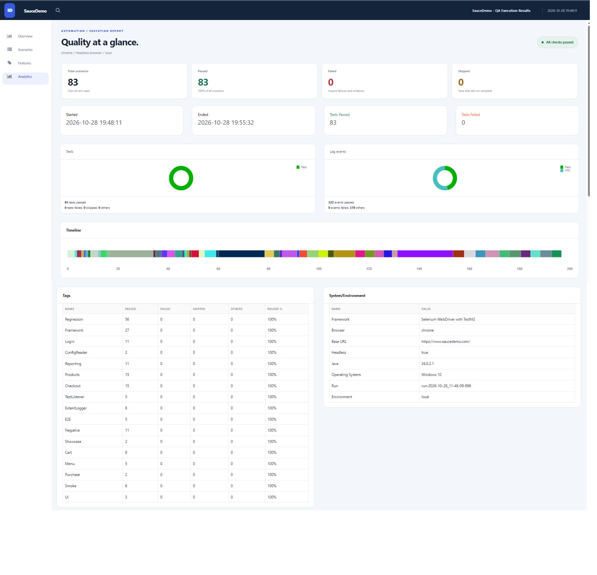

# 🧪 SauceDemo Selenium Automation Framework

### Java 17 | Selenium WebDriver | TestNG | Maven | Page Object Model | Extent Reports | GitHub Actions

A comprehensive web UI test automation framework developed to validate the core functionality of [SauceDemo](https://www.saucedemo.com/), a demonstration e-commerce application.

This project showcases practical Software Quality Engineering and SDET skills through automated functional testing, regression testing, reusable framework components, detailed execution reporting, and CI/CD integration.

The framework emphasizes **maintainability, test independence, reliability, and scalable automation architecture**, following industry-standard testing and software engineering practices.

---

## 📌 Project Overview

| Category | Details |
|---|---|
| Application Under Test | SauceDemo (Swag Labs) |
| Application Type | E-Commerce Web Application |
| Automation Type | Web UI Functional, Smoke, Regression & End-to-End Testing |
| Programming Language | Java 17 |
| Automation Framework | Selenium WebDriver |
| Testing Framework | TestNG |
| Build Tool | Apache Maven |
| Design Pattern | Page Object Model (POM) |
| Reporting | Extent Reports and Maven Surefire |
| CI/CD | GitHub Actions |
| Version Control | Git & GitHub |

### Project Objectives

- Automate critical e-commerce business workflows.
- Validate application functionality using positive and negative test scenarios.
- Implement a maintainable and reusable Selenium automation framework.
- Apply Page Object Model architecture for separation of concerns.
- Support multiple browsers and headless execution.
- Implement test data management and configuration handling.
- Generate detailed execution reports and diagnostic evidence.
- Integrate automated testing into a CI/CD pipeline.
- Demonstrate professional QA automation engineering practices.

---

## 🛠️ Technology Stack

| Technology | Purpose |
|---|---|
| Java 17 | Framework development and automation scripting |
| Selenium WebDriver | Browser automation and UI interactions |
| TestNG | Test execution, assertions, grouping, and lifecycle management |
| Maven | Build automation and dependency management |
| Page Object Model | Reusable and maintainable page components |
| Extent Reports | Interactive HTML execution reporting |
| Maven Surefire | Test execution results and XML/HTML reporting |
| GitHub Actions | Automated CI test execution |
| Git & GitHub | Source control and portfolio hosting |

---

## 🏗️ Framework Architecture

The project uses the **Page Object Model (POM)** design pattern with dedicated components for browser management, configuration, test execution, reporting, and reusable page interactions.

### Framework Structure

```text
saucedemo-testing/
│
├── src/
│   ├── main/
│   │   ├── java/com/portfolio/
│   │   │   ├── config/
│   │   │   ├── driver/
│   │   │   ├── pages/
│   │   │   └── utils/
│   │   └── resources/report/
│   │
│   └── test/
│       ├── java/com/portfolio/
│       │   ├── base/
│       │   ├── tests/
│       │   └── listeners/
│       └── resources/
│           └── testdata/
│
├── docs/
│   └── test-cases.md
│
├── screenshots/
│   ├── SauceDemo_Overview_Report.png
│   ├── SauceDemo_Feature_Report.png
│   └── SauceDemo_Analytics_Report.png
│
├── reports/
│   └── HTML Execution Report
│
├── test-reports/
│   └── Timestamped Execution Results
│
├── pom.xml
├── testng.xml
└── README.md
```

*The `test-reports/` directory is generated during test execution. Refer to the actual source tree for complete class and package details.*

### Key Framework Components

| Component | Responsibility |
|---|---|
| Configuration Management | Loads and validates framework settings |
| Driver Management | Creates and manages thread-local WebDriver instances |
| Page Objects | Encapsulates application locators and UI interactions |
| Base Test | Manages TestNG setup and teardown |
| Test Classes | Implements test scenarios and assertions |
| Test Data | Maintains expected values and reusable fixtures |
| Test Listeners | Captures execution events and reporting information |
| Utilities | Provides waits, currency parsing, screenshots, and reporting support |

---

## 🎯 Test Coverage

The framework covers major SauceDemo e-commerce workflows.

### 1. Authentication and Login Testing

- Login page element validation
- Successful login using valid credentials
- Invalid username and password handling
- Required-field validation
- Locked-out user behavior
- Logout functionality
- Supported demo user behavior

### 2. Product Inventory Testing

- Inventory page validation
- Product names, descriptions, and pricing
- Product sorting by name
- Product sorting by price
- Product detail navigation
- Product listing consistency

### 3. Shopping Cart Testing

- Add a single product
- Add multiple products
- Remove products
- Validate shopping cart contents
- Verify cart badge updates
- Continue shopping navigation

### 4. Checkout Testing

- Successful checkout
- Required customer information validation
- Checkout overview validation
- Product subtotal verification
- Tax and total calculation validation
- Order confirmation verification

### 5. Navigation and Menu Testing

- Application navigation
- Sidebar menu interactions
- Logout functionality
- Navigation between application pages

### 6. End-to-End Testing

Complete purchase workflows validate integration between the authentication, inventory, cart, and checkout modules.

```text
Launch SauceDemo
       ↓
Login with Valid Credentials
       ↓
View Product Inventory
       ↓
Select Products
       ↓
Add Products to Cart
       ↓
Review Shopping Cart
       ↓
Enter Checkout Information
       ↓
Verify Order Summary
       ↓
Complete Purchase
       ↓
Validate Order Confirmation
```

For the detailed automated scenario definitions, refer to [`docs/test-cases.md`](docs/test-cases.md).

---

## 🧠 Test Automation Strategy

The framework uses a structured testing approach.

| Testing Type | Purpose |
|---|---|
| Smoke Testing | Validate critical application functionality |
| Functional Testing | Verify expected feature behavior |
| Positive Testing | Verify valid user workflows |
| Negative Testing | Verify invalid inputs and error handling |
| Required-Field Validation | Verify mandatory form inputs |
| Regression Testing | Detect unexpected changes to existing functionality |
| End-to-End Testing | Validate complete business workflows |
| Framework Unit Testing | Verify supporting framework components |

### Automation Design Principles

**Test Independence:** Tests should not rely on the execution order or results of unrelated test methods.

**Reusable Components:** Common browser operations and page interactions are centralized.

**Explicit Synchronization:** WebDriver waits handle UI timing and reduce unnecessary fixed delays.

**Meaningful Assertions:** Tests validate expected outcomes rather than only performing interactions.

**Independent Expected Values:** Test data and expected results are maintained separately from the application responses.

**Failure Diagnostics:** Execution reports and screenshots provide evidence for debugging.

---

## ⚙️ Prerequisites

Before running the project, ensure the following are installed:

- Java JDK 17 or newer
- Apache Maven 3.9 or newer
- Google Chrome, Microsoft Edge, or Mozilla Firefox
- IntelliJ IDEA, Eclipse, or another Java-compatible IDE
- Internet connection for SauceDemo and Selenium Manager

---

## 🚀 Getting Started

### Step 1 — Clone the Repository

```bash
git clone https://github.com/janessa2297/qa-web-automation-selenium.git
```

### Step 2 — Navigate to the Project

```bash
cd qa-web-automation-selenium/saucedemo-testing
```

### Step 3 — Open in Your IDE

Open the `saucedemo-testing` project folder in IntelliJ IDEA or Eclipse.

Allow Maven to resolve and download the project dependencies.

### Step 4 — Execute the Test Suite

Run all configured framework and UI tests:

```bash
mvn clean test
```

### Browser-Specific Execution

Chrome with headless mode:

```bash
mvn clean test -Dbrowser=chrome -Dheadless=true
```

Microsoft Edge:

```bash
mvn clean test -Dbrowser=edge
```

Mozilla Firefox:

```bash
mvn clean test -Dbrowser=firefox
```

### Framework Tests Only

Execute framework verification tests without launching a browser:

```bash
mvn test -Dtest=ConfigReaderTest,MoneyUtilsTest,ExtentLoggerTest,TestListenerTest
```

The default build executes framework tests and the complete UI suite, including login, inventory, cart, checkout, menu, and end-to-end purchase scenarios.

---

## ⚡ Parallel Test Execution

The framework supports parallel execution at the TestNG test-context level.

- UI test contexts execute using two threads.
- Each thread maintains its own browser instance.
- Thread-local driver management helps isolate browser sessions.
- Parallel execution of methods within the same test instance is not supported.

This approach supports concurrent execution while preserving the intended test lifecycle.

---

## 🔧 Configuration Management

Default configuration values are stored in:

`src/test/resources/testdata/config.properties`

Configuration settings can be overridden using JVM system properties.

Example:

```bash
mvn clean test -DexplicitWaitSeconds=20
```

Timeout values must be positive integers.

Expected catalog values, validation messages, customer fixtures, and expected tax rates are maintained in `TestData`.

Only public demonstration credentials should be included in configuration files. Real credentials and secrets should not be committed to the repository.

---

## 📊 Test Execution Results

The following results were captured from the SauceDemo automation execution report dated October 28, 2026.

| Execution Metric | Result |
|---|---|
| Total Test Scenarios | 83 |
| Passed | 83 |
| Failed | 0 |
| Skipped | 0 |
| Pass Rate | 100% |
| Browser | Google Chrome |
| Execution Mode | Headless |
| Framework | Selenium WebDriver with TestNG |
| Execution Date | October 28, 2026 |
| Execution Duration | Approximately 7 minutes 21 seconds |

**Result: All 83 reported scenarios passed during the recorded execution.**

These results represent a specific test run and may differ depending on browser versions, environment configuration, application availability, and subsequent code changes.

---

## 📸 Test Execution Evidence

The following screenshots provide visual evidence of the SauceDemo Selenium Automation Framework's execution results, feature coverage, and reporting capabilities.

### 1. Test Execution Overview

Displays the overall execution summary, including passed, failed, and skipped test scenarios.



### 2. Feature Coverage

Provides an overview of the functional areas covered by the automation suite.



### 3. Test Execution Analytics

Displays execution metrics, pass/fail distribution, execution timeline, and environment information.



---

## 📑 HTML Test Execution Reports

Every Maven run generates a new timestamped directory under:

`test-reports/`

The generated execution artifacts include:

```text
test-reports/
└── <execution-timestamp>/
    ├── extent-report.html
    ├── surefire/
    │   ├── index.html
    │   └── testng-results.xml
    └── screenshots/
        └── Failure Evidence (when applicable)
```

### Extent Report

The Extent HTML report provides:

- Overall test execution dashboard
- Pass, fail, and skip statistics
- Execution duration and environment information
- Feature-level results
- Detailed test scenario logs
- Recorded assertions and exceptions
- Embedded failure screenshots when applicable
- Failure review information

### Maven Surefire Report

The Surefire report provides additional execution results, including test summary information and machine-readable XML output.

### Report Retention

Generated reports are stored outside Maven's `target/` directory so previous execution results can remain available after `mvn clean test`.

The report timestamp uses UTC.

An explicit `-DreportPath=...` setting can override the Extent report filename. Avoid reusing a fixed filename if historical reports must be retained.

---

## 🌐 How to Open the HTML Execution Report

A saved HTML execution report is also available in the repository's `reports/` directory.

### Steps to View the Report

1. Navigate to the `reports/` directory.
2. Download the HTML report and its associated resource folder, if included.
3. Keep the HTML file and resource folder together.
4. Locate the downloaded HTML file on your computer.
5. **Right-click the HTML file → Open with → Select your preferred browser.**
6. Choose Google Chrome, Microsoft Edge, or Mozilla Firefox.

### Report Navigation

| Tab | Description |
|---|---|
| Overview | High-level test execution summary |
| Scenarios | Individual automated scenarios and statuses |
| Features | Functional test coverage |
| Analytics | Execution statistics, charts, and timelines |

**Note:** The archived report uses Webpage, Complete HTML format. Its supporting resource folder must remain alongside the HTML file to preserve dependent styles, scripts, and images. Some browser features may be restricted when viewing local files.

---

## 🔄 Continuous Integration — GitHub Actions

The project includes GitHub Actions integration for automated test execution.

### CI Workflow

```text
Code Push / Pull Request
          ↓
GitHub Actions Workflow
          ↓
Set Up Java Environment
          ↓
Resolve Maven Dependencies
          ↓
Execute Selenium Tests
          ↓
Generate Test Reports
          ↓
Upload Execution Artifacts
```

### CI Capabilities

- Automated headless Chrome execution
- Maven-based test execution
- HTML and XML report generation
- Test artifact upload
- Report preservation when test execution fails

The workflow uploads generated `test-reports/` artifacts, including on failed test runs.

---

## 🧩 Engineering Practices

### Page Object Model

Separates UI locators and browser interactions from test assertions.

### Thread-Local Driver Management

Maintains browser instances per execution thread to support isolated parallel test contexts.

### Reusable Utilities

Centralizes waits, currency handling, screenshots, and reporting functionality.

### Configuration Validation

Validates framework settings before execution to reduce environment-related failures.

### Structured Test Reporting

Records execution outcomes and diagnostic information for test analysis.

### Version Control

Uses Git and GitHub to maintain project source code, documentation, and execution evidence.

---

## 📈 Future Enhancements

Potential improvements include:

- [ ] Expand data-driven test coverage.
- [ ] Add additional cross-browser execution evidence.
- [ ] Expand negative and boundary test scenarios.
- [ ] Improve automated accessibility testing coverage.
- [ ] Add test trend analysis across multiple executions.
- [ ] Introduce additional CI execution configurations.
- [ ] Improve execution performance and stability monitoring.
- [ ] Expand automated diagnostics for intermittent failures.

---

## 💼 Skills Demonstrated

This project demonstrates practical experience with:

- Java Programming
- Selenium WebDriver
- TestNG
- Apache Maven
- Page Object Model
- Test Automation Framework Design
- Functional Testing
- Smoke and Regression Testing
- Positive and Negative Testing
- End-to-End Testing
- Test Case Design
- Automated Assertions
- Browser Session Management
- Parallel Test Execution
- HTML Test Reporting
- CI/CD Integration
- Git and GitHub
- Software Quality Engineering

---

## 📚 Application Reference

**Application Under Test:** [SauceDemo — Swag Labs](https://www.saucedemo.com/)

SauceDemo is a demonstration e-commerce application used for practicing web application testing and automation techniques.

This is an independent professional portfolio project and is not affiliated with or endorsed by Sauce Labs.

---


## 👨‍💻 Portfolio Purpose

This project is part of the [QA Web Automation Selenium Portfolio](https://github.com/janessa2297/qa-web-automation-selenium), which showcases practical Selenium automation engineering across multiple web applications.

The goal is to demonstrate professional QA engineering skills through maintainable automation architecture, comprehensive functional validation, reliable test execution, and clear technical documentation.
